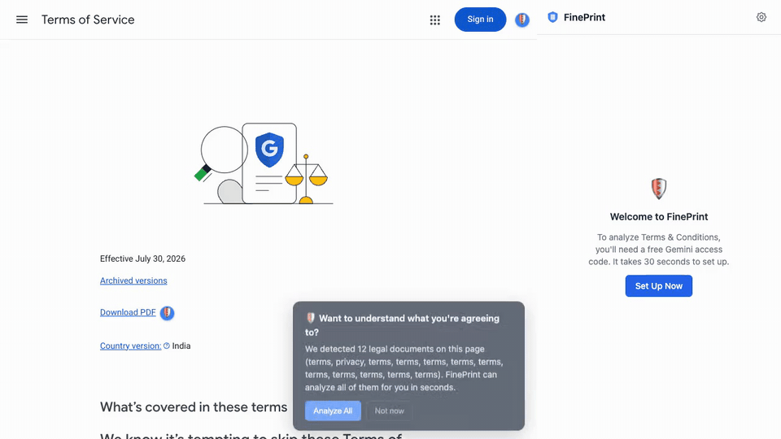

<p align="center">
  <b>A "nutrition label" for Terms &amp; Conditions: finds the legal links on a page and summarises them in plain English.</b><br>
  <sub>Chrome extension (Manifest V3) · TypeScript, React · built Mar–Apr 2026</sub>
</p>

<p align="center">
  <a href="assets/demo.mp4"></a>
  <br><sub>30-second demo, recorded from a real run of the unpacked build on Google's Terms of Service. No API key was used, so it shows detection, the prompt and the side panel's no-key state. The AI summary, score and red-flag results are not in the clip. <a href="assets/demo.mp4">MP4</a></sub>
</p>

### at a glance

```yaml
what:    plain-English summaries of T&C and privacy policies, with a 1-10 security score
checks:  instant regex checks for 10 red-flag patterns
stack:   [TypeScript, React 19, Tailwind, Vite + CRXJS, IndexedDB]
llm:     Google Gemini, with your own API key (the Claude adapter exists but isn't wired up)
install: build from source, load unpacked (not on the Chrome Web Store)
built:   Spring 2026 · solo side project
```

### the problem

The average Terms & Conditions document takes **47 minutes** to read. Nobody reads them. But buried inside are clauses about data selling, forced arbitration, content licensing and auto-renewal traps.

FinePrint runs in the background and watches for T&C and Privacy Policy links. A shield icon appears next to each detected legal link. One click analyses **all** legal documents on the page (Terms, Privacy Policy, Cookie Policy) and opens a side panel with each in its own tab.

### features

**Security score.** Every document gets a **1-10 score** across five dimensions, colour-coded green (8-10, low risk), yellow (4-7, medium) or red (1-3, high).

| Dimension       | What it measures                                         |
| --------------- | -------------------------------------------------------- |
| Data Collection | How much personal data is collected                      |
| Data Sharing    | Whether your data is sold to third parties (weighted 2x) |
| User Rights     | Your ability to delete, export, or control your data     |
| Liability       | How much the company disclaims responsibility            |
| Transparency    | How clear and readable the terms are                     |

**Red flag detection.** While the AI analysis is in flight, FinePrint scans the text with regex for **10 patterns**, with no extra network request: forced arbitration, data sale to third parties, class action waivers, auto-renewal traps, unilateral terms changes, broad content licensing, no refund policy, indefinite data retention, law enforcement data sharing (without warrant), and liability limitations.

**Smart link detection.** A 3-layer confidence score finds T&C links even in footers or behind vague text. Links need a combined confidence of at least 0.5. It is SPA-aware, so React/Next.js sites and Twitter/X don't re-prompt on every navigation.

```
Layer 1: URL patterns        → 0.9 confidence  (/terms, /privacy, /tos, /eula)
Layer 2: Link text matching  → 0.7 confidence  ("Terms of Service", "Privacy Policy")
Layer 3: Context heuristics  → 0.3 confidence  ("I agree to the...", checkbox nearby)
```

**Worst clause spotlight.** The most concerning clause is pulled out at the top of every analysis, with a plain-English explanation.

**Version diff tracking.** Revisit a site and FinePrint compares the current T&C with the last version it analysed: what was added, removed or changed, and how the score moved.

**Non-intrusive.** Badges and overlays use Shadow DOM, so they can't clash with a site's CSS. The prompt appears once per site per session, and clicking "Analyze" in the popup dismisses it.

### install

Needs Chrome (or any Chromium browser) and a free [Google Gemini API key](https://aistudio.google.com/apikey). FinePrint is not on the Chrome Web Store; it installs from source:

```bash
git clone https://github.com/kartikeyaagr/fineprint.git
cd fineprint
npm ci
npm run build
```

1. Open `chrome://extensions` and enable **Developer mode**.
2. Click **Load unpacked** and select the `dist/` folder.
3. On first install, an onboarding page walks through adding the Gemini key (about 30 seconds).

### how it works

1. **Detection.** The content script scans each page for links matching URL patterns, text patterns and consent context, and combines the confidences.
2. **Badges.** Detected links get a shield via Shadow DOM: blue = unanalysed, green/yellow/red = scored, spinning = in progress.
3. **Extraction.** On click, the service worker fetches the T&C URL and extracts clean text with regex-based HTML parsing (service workers have no DOM).
4. **Red flag scan.** The 10 regex patterns run over the extracted text.
5. **LLM analysis.** The text goes to Gemini with a structured prompt. The response is parsed into clauses, severities and the score breakdown.
6. **Caching.** Results are stored in IndexedDB. Revisits are served instantly, and a changed T&C triggers a diff.
7. **Display.** The side panel shows one tab per document (Terms, Privacy, Cookies), each with security score, full clause summary and version diff.

### security and privacy

- **No backend server.** Everything runs in your browser.
- **Your API key stays local.** Stored in `chrome.storage.local` and sent only to the Gemini API.
- **Minimal permissions.** Only `activeTab`, `storage`, `tabs` and `sidePanel`.
- **Prompt injection defence.** Strict role separation and schema validation; instructions embedded in T&C text are treated as data.
- **Shadow DOM isolation** for all injected UI.

The full policy is in [PRIVACY_POLICY.md](PRIVACY_POLICY.md).

### architecture

<details>
<summary>diagram, tech stack and project structure</summary>

```
┌─────────────────────────────────────────────────────────────┐
│                     CHROME EXTENSION                         │
│                                                              │
│  Content Script          Service Worker        Side Panel UI  │
│  (runs on every page)    (background)          (React)       │
│                                                              │
│  ┌─────────────────┐    ┌──────────────────┐  ┌───────────┐ │
│  │ Link Detector   │───▶│ T&C Extractor    │  │ Security  │ │
│  │ Badge Injector  │    │ LLM Orchestrator │─▶│ Summary   │ │
│  │ Overlay Prompt  │◀───│ Cache (IndexedDB) │  │ Diff View │ │
│  │ SPA Handler     │    │ Red Flag Scanner │  │ Settings  │ │
│  └─────────────────┘    │ Diff Engine      │  └───────────┘ │
│                          └──────────────────┘                │
│                                  │                           │
│                          ┌───────▼───────┐                   │
│                          │  Gemini API   │                   │
│                          │  (user's key) │                   │
│                          └───────────────┘                   │
└──────────────────────────────────────────────────────────────┘
```

| Layer               | Technology                         |
| ------------------- | ---------------------------------- |
| Extension framework | Chrome Manifest V3                 |
| UI                  | React 19 + Tailwind CSS            |
| Language            | TypeScript 5.8                     |
| Build               | Vite + CRXJS                       |
| Storage             | IndexedDB (via `idb`)              |
| AI                  | Google Gemini API (user's own key) |
| Content isolation   | Shadow DOM                         |

```
src/
├── content/          # Content scripts (detection, badges, overlay)
│   ├── detector.ts   # 3-layer confidence scoring
│   ├── badge.ts      # Shield badge injection (Shadow DOM)
│   ├── overlay.ts    # "Want to understand?" prompt
│   └── content.ts    # Entry point, SPA navigation handling
├── background/       # Service worker
│   ├── extractor.ts  # T&C text extraction from HTML
│   ├── analyzer.ts   # Analysis pipeline orchestrator
│   ├── cache.ts      # IndexedDB caching layer
│   ├── diff.ts       # Version comparison engine
│   ├── rating.ts     # Security score computation
│   ├── red-flags.ts  # Instant regex pattern scanner
│   └── llm/          # LLM adapter layer
│       ├── adapter.ts
│       ├── gemini.ts  # Google Gemini adapter
│       ├── prompts.ts # Prompt templates with injection defense
│       └── utils.ts   # Response parsing, retry logic
├── ui/
│   ├── sidepanel/    # Side panel UI (React)
│   └── onboarding/   # First-install setup page
├── shared/           # Types, constants, message passing
└── utils/            # Storage helpers, text processing
```

</details>

### development

```bash
npm run dev        # dev server with hot reload
npm run typecheck  # type checking
npm run lint       # lint
npm run build      # production build to dist/
```

Reload the extension in `chrome://extensions` after building. The demo is reproducible with `npm i --no-save playwright && node assets/record_demo.mjs` (writes `assets/demo.mp4` and `assets/demo.gif`).

### license

MIT


